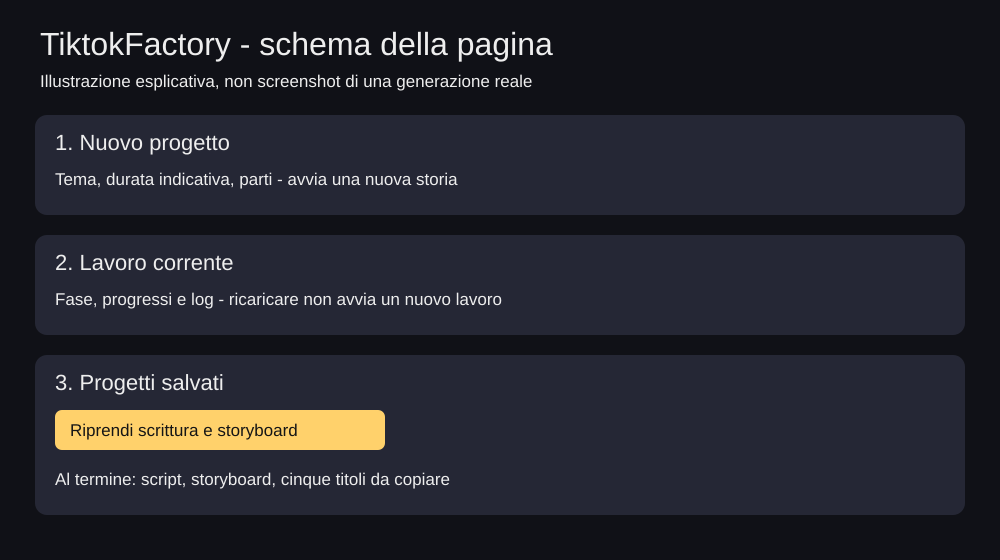

# TiktokFactory — guida completa da zero

Applicazione locale per preparare racconti italiani con LM Studio. La pagina web elenca i progetti salvati, mostra i progressi, riprende la scrittura dal piano e propone cinque titoli.

> Stato reale: la ripresa web completa **scrittura, storyboard e titoli**, non voce o video. Il pulsante Nuovo progetto prova anche la pipeline multimediale esistente, ancora da collaudare sul proprio PC. Durate e sottotitoli sono stimati. Questo aggiornamento non genera immagini o animazioni. Le revisioni dello stesso modello non garantiscono la qualita narrativa.

## 1. Prerequisiti

Servono Windows, Python 3.12, LM Studio e spazio per modello e progetti. Per il video serve anche FFmpeg nel PATH. Il primo download di pacchetti e modello richiede Internet. Non occorrono servizi AI cloud per il racconto.

- Python: https://www.python.org/downloads/windows/ — installare anche il launcher `py`. Verificare in PowerShell con `py -3.12 --version`.
- LM Studio: https://lmstudio.ai/ — installare, cercare e scaricare un modello compatibile con la memoria del PC. Non viene imposto un modello o una quantizzazione.
- FFmpeg: https://ffmpeg.org/download.html — sezione Windows EXE Files. Scegliere una build collegata dal sito, estrarla e aggiungere al PATH utente la cartella contenente `ffmpeg.exe`. Riaprire PowerShell e controllare `ffmpeg -version`. Un pacchetto Python con nome simile non sostituisce l'eseguibile.

## 2. Scaricare ed estrarre il progetto

1. Aprire questo repository su GitHub.
2. Premere **Code > Download ZIP**.
3. Fare clic destro sullo ZIP e scegliere **Estrai tutto**.
4. Aprire la cartella estratta.
5. Individuare la cartella che contiene davvero `Avvia.bat`, `requirements.txt`, `.env.example` e `app`.

Una doppia cartella `TiktokFactory-main/TiktokFactory-main` e possibile: conta il contenuto, non il nome. Non lavorare dentro lo ZIP e non eseguire i comandi da `C:\Windows\System32`.

Alternativa, solo se Git e installato:

```powershell
git clone https://github.com/Vincisus/TiktokFactory.git
cd TiktokFactory
```

## 3. Preparare LM Studio

1. Aprire LM Studio.
2. Scaricare un modello, poi **caricarlo**. Scaricato e caricato non significano la stessa cosa.
3. Aprire Developer / Local Server; le etichette dipendono dalla versione.
4. Avviare il server locale. Deve risultare Running su `http://127.0.0.1:1234`.
5. Copiare **API Model Identifier**, non il titolo commerciale del modello.
6. Lasciare LM Studio acceso per tutta la generazione.

Documentazione ufficiale: https://lmstudio.ai/docs/developer/core/server

Il server dell'app e quello di LM Studio sono distinti: **8000** per TiktokFactory, **1234** per il modello. Non esporli con host `0.0.0.0` o port forwarding. Usare una sola istanza di TiktokFactory, senza `--reload` o piu worker.

## 4. Primo avvio con doppio clic

Con LM Studio gia acceso, fare doppio clic su **Avvia.bat**. Il launcher:

1. Si posiziona nella cartella corretta.
2. Crea `.venv` con Python 3.12 se manca.
3. Installa le dipendenze al primo utilizzo, senza chiedere di attivare script PowerShell.
4. Copia `.env.example` in `.env` soltanto se `.env` non esiste.
5. Se il server espone un solo modello, ne imposta l'identificatore; altrimenti lo chiede.
6. Installa automaticamente il recupero narrativo, con backup e test, se non e gia presente.
7. Avvia Uvicorn e apre il browser.

Il launcher **non installa Python, LM Studio, il modello o FFmpeg**. Se qualcosa fallisce, la finestra rimane aperta: leggere e conservare il messaggio. Non avviare altre copie per tentare di sbloccare la prima.

### Controllare la configurazione

Aprire `.env` con Blocco note. I valori devono corrispondere al proprio server:

```env
LMSTUDIO_BASE_URL=http://127.0.0.1:1234/v1
LMSTUDIO_API_KEY=lm-studio
LMSTUDIO_MODEL=INCOLLA_QUI_L_API_MODEL_IDENTIFIER
LMSTUDIO_MAX_TOKENS=4096
LMSTUDIO_TOTAL_TIMEOUT=1800
LMSTUDIO_IDLE_TIMEOUT=300
```

Sostituire il valore di esempio del modello con quello esatto di LM Studio. Non condividere chiavi personali o `.env` pubblico. Riavviare l'app dopo aver cambiato configurazione, mai durante un lavoro.

Se `.env` esiste gia, il launcher lo conserva: non corregge automaticamente valori personalizzati o sbagliati.

## 5. Aprire la pagina web

Se il browser non si apre da solo, visitare:

http://127.0.0.1:8000/static/index.html



La figura e un'illustrazione dell'interfaccia, non una prova di generazione riuscita. Nella pagina **Guida illustrata** e presente anche un ritaglio di una schermata reale del recupero precedente:

http://127.0.0.1:8000/static/guide.html

La schermata reale riguarda il recupero terminale, non il nuovo browser. Percorsi personali e notifiche sono esclusi dal ritaglio. Non vengono presentate schermate simulate come fotografie di un collaudo riuscito.

## 6. Creare un nuovo progetto

1. Scrivere un tema o una richiesta originale.
2. Scegliere la durata indicativa, da 10 a 30 minuti.
3. Scegliere 3 o 4 parti TikTok.
4. Premere **Genera nuovo progetto** una volta sola.
5. Leggere il passaggio corrente e i log sotto la barra.
6. Attendere: una correzione e lavoro attivo, non necessariamente un blocco.

La nuova generazione prova concept, struttura, scene, storyboard, voce, sottotitoli, rendering, clip e metadati. Puo fermarsi per problemi narrativi, di modello, audio o rendering. Completare scrittura/storyboard NON equivale a ottenere un video pubblicabile. Il controllo qualita non sostituisce l'ascolto e la visione manuale.

La percentuale rappresenta le fasi, non una previsione del tempo residuo. Durante una chiamata al modello puo restare ferma. La pagina mostra i passaggi disponibili, non tutti i token generati.

## 7. Riprendere dal browser un progetto interrotto

1. Non eliminare `projects`.
2. Se un recupero sta gia girando in terminale, aspettarne la conclusione. Non lanciare lo stesso progetto contemporaneamente dal web.
3. Avviare l'app con `Avvia.bat`.
4. Scorrere a **Progetti salvati**.
5. Identificare il progetto dal titolo e dall'ID. Non scegliere a caso il piu recente.
6. Premere **Riprendi scrittura e storyboard**.
7. Confermare la richiesta nella finestra del browser.
8. Seguire il lavoro nella pagina. Ricaricarla non crea un nuovo job.

Si riusano `brief.json`, `concept.json` e `structure.json`. Le scene approvate dalla versione di recupero vengono riutilizzate tramite checkpoint. Se piano, scene precedenti o checksum non corrispondono, la ripresa si ferma per non mescolare storie diverse. Le vecchie bozze senza checkpoint non sono considerate automaticamente approvate.

Al termine si ottengono script, storyboard e cinque titoli. **Questo pulsante non riprende la fase multimediale:** non avvia voce, video o pubblicazione. I progetti senza piano completo non sono riprendibili con questo comando.

### Lock e lavori interrotti

Un lock impedisce una seconda generazione mentre il recupero usa il progetto, anche se proviene dal terminale. Non cancellarlo per forzare un avvio parallelo.

Dopo un arresto forzato potrebbe rimanere `projects/ID/.scene_recovery.lock`. Solo dopo aver chiuso TUTTE le istanze web e terminale e verificato che nessun lavoro sia attivo, eliminare quel singolo file con Esplora file e riavviare. Non cancellare la cartella del progetto. Il programma non rimuove automaticamente i lock perche non puo sapere con certezza se un altro processo stia ancora scrivendo.

I job di recupero sono salvati in `resume_job.json`; quelli originali in `job_status.json`. Dopo il riavvio un job non piu attivo viene mostrato come interrotto, non come ancora in esecuzione. Il server non rilancia lavori da solo.

## 8. Proposte di titolo

Alla fine della ripresa vengono salvati cinque titoli in `title_options.json` e mostrati sotto il progetto. Le nuove generazioni complete li ricevono anche nei metadati. Se la proposta del modello fallisce, si usano varianti dichiarate come fallback nel file: rivederle sempre.

Fare clic su un titolo per copiarlo. La copia non pubblica nulla, non rinomina file e non modifica automaticamente il titolo del video sulle piattaforme. La scelta resta locale nel browser.

## 9. Dove trovare i risultati

```text
projects/ID/
  brief.json                  richiesta originale
  concept.json                concept approvato
  structure.json              piano approvato
  scenes/                     schede, bozze, revisioni, checkpoint
  script_partial.md           scene approvate fino a quel punto
  script.md                   narrazione completa
  storyboard.json             storyboard con tempi stimati
  title_options.json          cinque titoli della ripresa
  resume_job.json              stato del recupero web
  job_status.json              stato della generazione originale
  metadata.json               metadati, se la pipeline li ha raggiunti
```

Dalla pagina si puo scaricare lo script. Gli endpoint di download espongono anche storyboard, titoli e stato del recupero, se presenti. Audio, render e clip compaiono soltanto se le rispettive fasi sono riuscite.

Prima degli aggiornamenti conservare copie di `.env`, `projects` e degli asset personali. I backup del vecchio installatore sono in `.recovery_backups`.

## 10. Aggiornare senza perdere progetti

NON aggiornare mentre modello o server stanno lavorando.

- **Con Git:** fermare il server, salvare le proprie modifiche, poi usare `git pull`. Se compaiono conflitti, fermarsi; non usare `reset --hard` sui propri dati.
- **Con ZIP:** fare prima un backup, estrarre la nuova versione in una cartella separata, quindi trasferire `.env` e `projects` nella nuova cartella. Non eliminare la vecchia prima di aver verificato il recupero.
- Non copiare `.venv` tra cartelle: la nuova viene creata dal launcher.
- Se il recupero terminale era gia installato nella stessa cartella, non occorre rilanciare manualmente `apply_scene_recovery.py`: il launcher riconosce il metodo presente.

## 11. Risoluzione dei problemi

| Messaggio o situazione | Controllo |
|---|---|
| Pagina non raggiungibile | Uvicorn deve essere acceso, non basta LM Studio |
| Modello non trovato | Identificatore in `.env`, modello caricato, porta 1234 |
| Risposta finale vuota | Un solo recupero; diagnostica salvata; reasoning mai usato come copione |
| Scheda versione 2/3 | Prima correzione dopo un rifiuto, non seconda scena |
| Un lavoro e gia attivo | Controllare finestre web/terminale e lock; non avviare copie |
| `Ran` o `OK` non riconosciuti | Sono risultati dei test, NON comandi da incollare |
| `SyntaxWarning` su `\d` | Avviso del vecchio installatore: leggere l'esito finale dei test |
| FFmpeg assente | Recupero narrativo possibile; il video richiede l'eseguibile nel PATH |
| Versione del codice inattesa | Non forzare la patch; conservare backup e messaggio |

## 12. Test e limiti del collaudo

Dalla cartella del progetto, dopo la preparazione dell'ambiente:

```powershell
.\.venv\Scripts\python.exe -m unittest discover -s tests -p "test_web_recovery.py" -v
.\.venv\Scripts\python.exe -m unittest discover -s tests -p "test_scene_recovery.py" -v
```

I test usano modelli simulati. Non verificano la qualita del modello reale o la produzione completa di video sul proprio Windows. L'aggiornamento web e stato controllato sintatticamente e tramite test isolati delle funzioni di recupero; il collaudo HTTP/browser e multimediale va eseguito nell'ambiente installato. Non sono garantiti tempi, durata audio effettiva, animazioni o sincronizzazione parola per parola.
